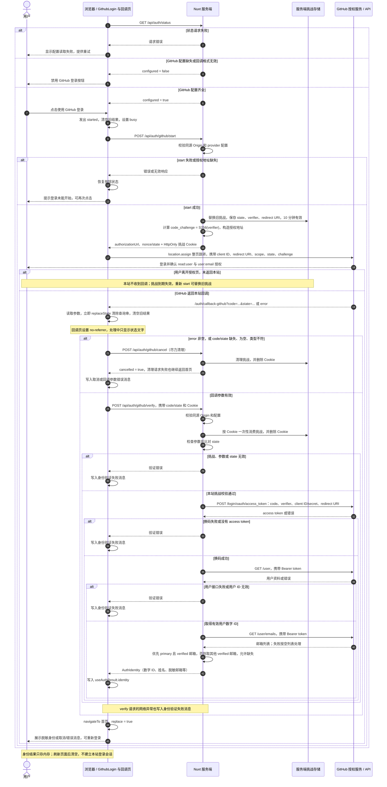

# GitHub 登录案例

入口：`/`，回调：`/auth/callback-github`。源码：`app/components/auth/GithubLogin.client.vue`、`app/pages/auth/callback-github.vue`、`server/api/auth/[provider]/start.post.ts`、`server/providers/github.ts`。

## 原理

保留源 OAuth App **Authorization Code + PKCE（S256）**。当前 GitHub OAuth Apps 支持 PKCE，但服务端换 token 仍需 client secret。

1. 浏览器 POST `/api/auth/github/start`，服务端生成 state 和 PKCE verifier，保存在浏览器绑定挑战中，返回授权地址。
2. 浏览器跳到 `/login/oauth/authorize`，携带 client_id、redirect_uri、state、scope、code_challenge 与 S256。
3. GitHub 回调 `/auth/callback-github?code=...&state=...`。页面立即清理可见 URL，再向本站服务端 POST code/state。
4. 服务端消费挑战、核对 state，向 `/login/oauth/access_token` 发送 client_id、client_secret、code、原 code_verifier 与 redirect_uri。
5. 用 token 调 `GET https://api.github.com/user` 确认身份，另查 `/user/emails` 获取已验证邮箱。浏览器只收脱敏身份，不收 access token。

state 关联授权、防登录 CSRF；PKCE 绑定授权与换码方，不能替代 state。verifier 不再存 localStorage，也不从客户端请求体信任。

## 完整流程图

下图对应整页跳转的 Authorization Code + PKCE 流程。PKCE verifier 和 client secret 只在本站服务端使用，access token 不返回浏览器。



## 平台后台配置

1. GitHub **Settings → Developer settings → OAuth Apps**，使用源 OAuth App 或新建。
2. 设置 Homepage URL 与 **Authorization callback URL**，本项目保留 `/auth/callback-github`。
3. 核对实际回调的协议、主机、端口和路径，明确登记要使用的回调地址。
4. 记录公开 Client ID 与服务端专用 client secret。

回调规则依应用 wildcard 设置而变；当前官方说明部分历史应用保留兼容行为，不能假定任何回调子路径都允许。loopback 端口另有规则，以后台和官方文档为准。GitHub 推荐本地 loopback IP；本例保留源实现的当前 origin 推导，localhost/127.0.0.1 切换也需核对登记值。

## 环境变量与运行

```dotenv
NUXT_PUBLIC_GITHUB_CLIENT_ID=<OAuth App client ID>
# 为空时：当前 origin + /auth/callback-github
NUXT_PUBLIC_GITHUB_REDIRECT_URI=
NUXT_GITHUB_CLIENT_SECRET=<server-only client secret>
```

在 `.env` 的 GitHub 分组填写，顺序与 `.env.example` 一致；示例文件中这三项默认留空。源 VITE_GITHUB_CLIENT_ID 和 GITHUB_CLIENT_SECRET 映射到上述 Nuxt 变量。secret 只用于服务端，不应放入 public runtimeConfig。修改后重启开发服务。

未配置回调变量时使用动态 origin 推导。例如默认开发地址下为 `http://localhost:3000/auth/callback-github`。也可用变量覆盖，但该 URL 必须真正指向本应用且平台获准；指向其他站点无法回到当前 Cookie 绑定的流程。

运行 `pnpm dev`，默认端口为 `3000`，实际地址以终端为准。打开首页 `/`，点击登录；回调验证完成后自动返回首页展示身份。

## 组件与回调行为

父组件局部模板：

```vue
<AuthGithubLogin
  :configured="status.configured"
  @started="resetResult"
/>
```

`status` 和 `resetResult` 由父组件提供。缺少 client ID/secret 或回调格式无效时，按钮禁用并提示未配置。点击后发出 `started`，请求 start 接口，再用 `window.location.assign(authorizationUrl)` 整页跳转；发起失败时恢复按钮并显示重试提示。

GitHub 组件不发出 `verified`。还需保留 start/verify/cancel 接口、runtimeConfig 和回调页：

- 回调页挂载后读取 code/state/error，立即通过 `history.replaceState` 从可见 URL 移除查询参数；页面同时设置 `no-referrer`。
- code/state 必须是非空字符串。取消授权、缺参或参数类型不符时，尽力调用 cancel 清理挑战，并设置对应消息。
- 参数有效时向 verify 提交 code/state，将脱敏身份或验证错误写入 `useAuthResult()`。
- 最后用 `navigateTo('/', { replace: true })` 返回首页，回调处理中只显示状态文字。

结果只存在于当前 Nuxt 应用内存，刷新后清空。统一 `AuthIdentity` 字段及结果展示见 [总览](README.md#组件与结果)。

## 权限与用户资料

沿用源 scope `read:user user:email`：前者读取用户资料，后者调用 `/user/emails`，不能假定 `/user.email` 必有值。服务端优先选择 primary 且 verified 的邮箱，否则选择其他 verified 邮箱。邮箱接口失败或无已验证邮箱时仍能确认 GitHub 用户 ID，页面显示邮箱未提供。

不请求仓库、组织管理或写权限。每次新 token 都重新调 `/user`；`subject` 为数字 ID 的字符串形式，`name` 优先使用用户姓名，否则使用 login。邮箱经过脱敏再返回浏览器，身份判断使用稳定数字 ID。

## 常见问题

| 现象 | 排查 |
| --- | --- |
| redirect_uri 不匹配 | 比较环境变量、平台后台和实际回调地址；变量为空时为当前 origin + /auth/callback-github |
| state 错误/过期 | Cookie 清理、服务重启、超过 10 分钟、重复回调、多标签页覆盖；重新开始 |
| bad_verification_code | code 已使用/超过 GitHub 10 分钟有效期，或 verifier 错误 |
| secret 错误 | 检查运行时 NUXT_GITHUB_CLIENT_SECRET，不放 public 配置 |
| 邮箱缺失 | 隐藏邮箱或缺权限，不等于身份确认失败 |
| 取消授权 | 回调清理挑战并返回首页显示取消提示，可重新登录 |

## 验收

在正确配置下真实授权、确认身份；取消后可重试；篡改 state、缺参、重复或过期回调无法成功；成功/失败结果均不含 token。自动测试不代表后台已放行当前回调。公共检查命令及 smoke 脚本说明见 [总览](README.md#验证)。

## 官方参考

- [OAuth 授权、PKCE、换 token 与回调规则](https://docs.github.com/en/apps/oauth-apps/building-oauth-apps/authorizing-oauth-apps)
- [Get the authenticated user](https://docs.github.com/en/rest/users/users#get-the-authenticated-user)
- [List email addresses](https://docs.github.com/en/rest/users/emails#list-email-addresses-for-the-authenticated-user)
- [OAuth scopes](https://docs.github.com/en/apps/oauth-apps/building-oauth-apps/scopes-for-oauth-apps)
