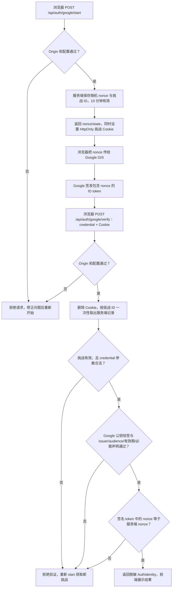
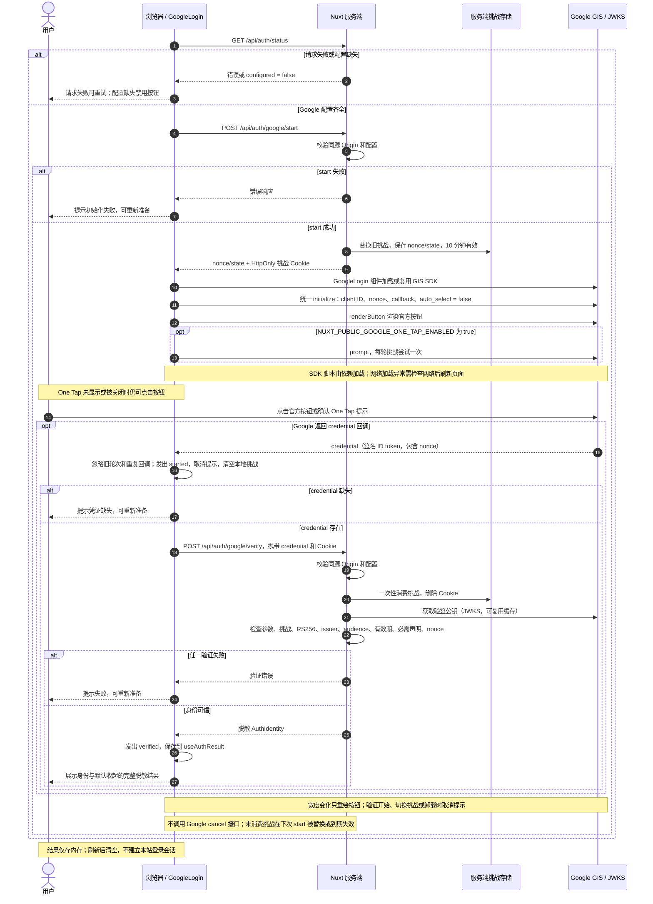
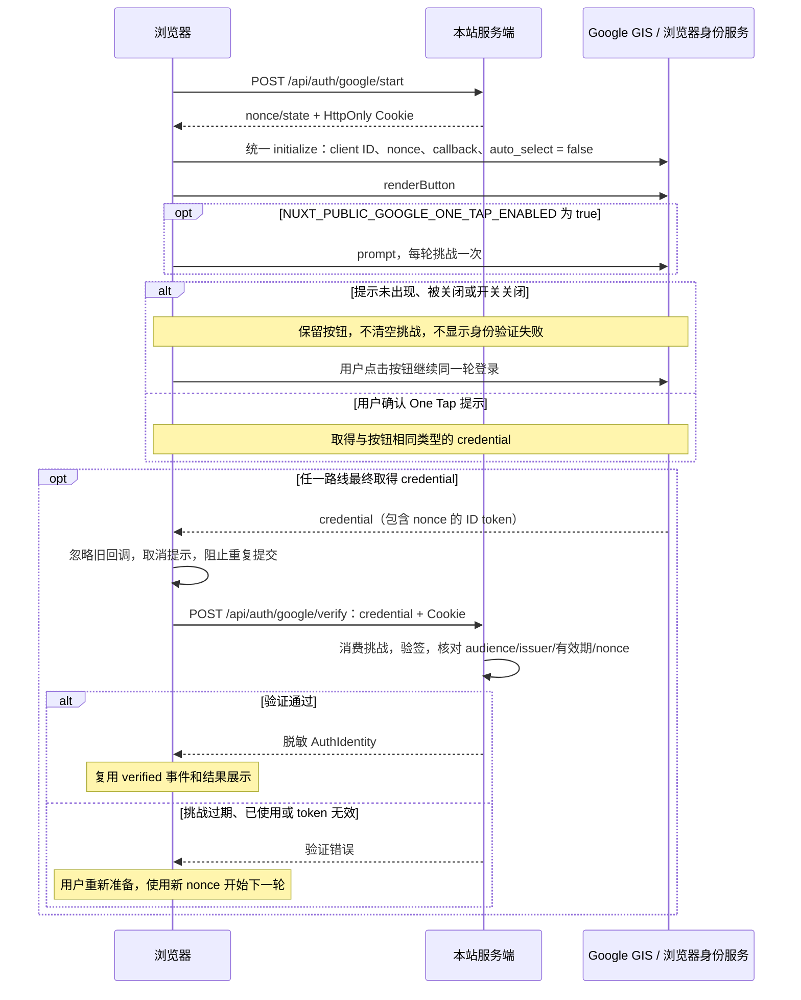

# Google 登录案例

入口：`/`。源码：`app/components/auth/GoogleLogin.client.vue`、`server/providers/google.ts`、`server/utils/auth-tokens.ts`。

## 原理

沿用源项目的 `vue3-google-login` 组件与 Google Identity Services 官方按钮。依赖固定为 `2.1.4`，通过 pnpm 补丁让按钮和 One Tap 复用 nonce 初始化配置。用户选择账号后，SDK `credential` 是 Google 签名的 **ID token**，不是 access token。本例不申请 Google API 权限，不使用授权码、refresh token 或 Google client secret。

客户端先向 `/api/auth/google/start` 获取一次性 nonce，交给 GIS `id-configuration`。收到 credential 后 POST `/api/auth/google/verify`。服务端通过临时 Cookie 消费挑战，用 Google 公钥验证 RS256 签名，核对：

- issuer 为 `accounts.google.com` 或 `https://accounts.google.com`。
- audience 与服务端 Google Web client ID 一致。
- 未过期，包含 `sub`、`iat`、`exp`、`nonce`。
- nonce 与本次挑战一致。

返回统一的 `AuthIdentity`：`provider: 'google'`、`subject`（token 的 sub）、可选姓名、脱敏邮箱、邮箱验证状态。完整 credential 不包含在身份结果中。身份字段与公共接口见 [总览](README.md)。

## start 与 verify 接口

这两个接口都是本站 Nuxt 接口。`start` 准备“这次登录”的校验信息，`verify` 确认“Google 身份可信，而且属于这次登录”；前端收到 credential 不等于本站已经验证通过。

### POST /api/auth/google/start：准备挑战

浏览器在显示 Google 入口前调用，无需业务请求体，必须同源访问并接受 Cookie。

1. 校验请求 Origin 与本站一致，并检查 Google client ID 是否已配置。
2. 生成随机挑战 ID、nonce 等临时数据，存入服务端内存，10 分钟有效。当前浏览器已有 Google 挑战时替换旧记录。
3. 设置 `oauth_demo_google` Cookie，内容为挑战 ID；使用 HttpOnly、SameSite=Lax、path=/，HTTPS 时开启 Secure。
4. 返回以下 JSON，前端将 nonce 传给 GIS 初始化配置：

```json
{
  "nonce": "<本次登录的随机数>",
  "state": "<通用 start 接口返回的随机状态值>"
}
```

Google 路线使用 nonce 关联 ID token 与挑战；这里的 state 来自多 provider 共用的返回结构，当前 Google 组件不使用它，verify 也不要求提交它。挑战 ID 由 Cookie 自动携带，不在上述 JSON 中返回。

`start` 不替用户登录 Google，不验证身份，也不创建本站登录会话。常见错误为非同源请求 `403`、缺少配置 `503`、待完成挑战达到容量上限 `429`。

### POST /api/auth/google/verify：确认身份

Google SDK 返回 credential 后，由浏览器在同源请求中提交；浏览器同时自动携带 start 设置的 Cookie：

```json
{
  "credential": "<Google 返回的完整 ID token>"
}
```

服务端依次执行：

1. 检查 Origin 和 Google 配置。
2. 按 Cookie 查找 Google 挑战，删除 Cookie 并一次性消费记录；不存在、过期或已使用的挑战立即拒绝。
3. 检查 credential 是非空字符串，长度不超过 20000。
4. 使用 Google JWKS 公钥验证 ID token 的 RS256 签名。`jose` 可复用公钥缓存；此处不使用 access token，也不把 token 发给 `tokeninfo` 作为正式验证方式。
5. 核对 issuer、audience、有效期及必需声明 `sub`、`iat`、`exp`、`nonce`，再以安全比较核对 token 中的 nonce 与服务端挑战一致。
6. 仅提取允许返回的身份字段，脱敏邮箱，返回 `AuthIdentity`：

```json
{
  "provider": "google",
  "subject": "<Google sub>",
  "name": "<可选姓名，也可能为 null>",
  "email": "d***@example.com",
  "emailVerified": true
}
```

姓名、邮箱缺失时返回 null；示例中的邮箱和验证状态仅示意返回结构，不保证账号一定提供邮箱。

常见错误为非同源请求 `403`、缺少配置 `503`、挑战或参数无效 `400`、签名或身份声明验证失败 `401`。**挑战在读取请求体和验签前已消费**：执行到消费步骤后，即使后续验证失败，也必须重新 start，不能反复提交同一挑战。

### 两个接口如何形成验证链路

签名证明 token 由 Google 签发且未被篡改，audience 证明 token 面向本应用，nonce 与 Cookie 绑定的一次性挑战共同确认它属于当前浏览器发起的这次登录，从而防止凭证重放和登录结果被替换。



源码分工：`server/api/auth/[provider]/start.post.ts` 生成挑战，`server/api/auth/[provider]/verify.post.ts` 分发到 `server/providers/google.ts`；`server/utils/auth.ts` 处理同源检查与 Cookie，`auth-core.ts` 处理一次性存储，`auth-tokens.ts` 处理验签和 nonce 比对。

## 完整流程图

按钮与可选 One Tap 使用同一轮挑战和验证回调；只有服务端验证通过后才展示身份。



## 平台后台配置

1. 打开 [Google Auth Platform](https://console.cloud.google.com/auth/clients)，选择或创建项目。
2. 配置 Branding、Audience、OAuth consent；测试阶段添加获准测试用户。
3. 创建或使用 **Web application** 类型 OAuth client ID。
4. 在 **Authorized JavaScript origins** 登记实际站点 origin（协议、主机、端口，不能带路径）。本地示例为 `http://localhost` 和 `http://localhost:3000`，实际端口以终端为准。部署后登记实际 HTTPS origin。
5. 当前使用 **popup + JavaScript callback**，无需新增 Google 回调路由。只有改用 redirect/login_uri 才配置 Authorized redirect URIs，并实现对应 POST/CSRF 处理。

迁移来源的 client ID 不一定已允许当前站点 origin；应在与实际 client ID 对应的后台核对。

## 环境变量与运行

```dotenv
NUXT_PUBLIC_GOOGLE_CLIENT_ID=<Web application client ID>
NUXT_PUBLIC_GOOGLE_ONE_TAP_ENABLED=false
```

在 `.env` 的 Google 分组填写 client ID；`.env.example` 的 client ID 默认留空，One Tap 开关默认 `false`。源 `VITE_GOOGLE_CLIENT_ID` 映射到 `NUXT_PUBLIC_GOOGLE_CLIENT_ID`，这是公开标识，不是 secret。修改后重启开发服务。

```bash
pnpm install
pnpm dev
```

开发端口配置为 `3000`，实际端口以终端为准。访问 `http://localhost:3000/`，点击官方按钮并选择账号。成功后显示“身份验证通过”和脱敏身份；“查看完整结果”默认收起，刷新后清空。

## 组件行为

1. 组件挂载且 `configured` 为 true 时，请求 start 接口取得 nonce，再挂载 `<GoogleLogin>`；SDK 加载和官方按钮渲染由依赖负责。
2. `prompt` prop 使用环境开关，`auto-login` 固定 false，`id-configuration` 传入 nonce 和 `ux_mode: 'popup'`。补丁让 prompt 复用按钮初始化配置，不再覆盖 nonce。
3. `ResizeObserver` 更新容器宽度，通过 `button-config.width` 传给子组件。子组件的 key 仅使用 nonce；补丁监听宽度变化并只重绘按钮，不重新 initialize 或 prompt。
4. 按钮点击或 credential 验证开始时发出 `started`，清空旧结果。回调先核对轮次，再调用 verify；成功发出 `verified(AuthIdentity)`。
5. 开始验证时清空本地挑战，子组件卸载并取消提示；重复和旧轮次回调被忽略。start 或验证失败时提供重新准备入口，使用新 nonce 开始下一轮。
6. One Tap 未显示、被关闭或 prompt 抛错时保留按钮，不当作身份验证失败。按钮弹窗关闭且没有 credential 回调时，仍可再次点击按钮。

缺少 client ID 时按钮禁用；One Tap 开关是可选项，不影响 provider 的 configured 状态。组件卸载时断开 ResizeObserver、取消提示并忽略未完成请求的结果。

本仓库不再维护独立的 Google SDK 加载器或 15 秒超时逻辑。SDK 脚本加载由依赖负责；网络加载异常时先检查网络、CSP 与扩展，再刷新页面。页面的“重新准备”用于重新请求挑战以及恢复授权/验证失败，不代表该依赖具有脚本网络失败后的自动恢复能力。

## 复用

读取 `/api/auth/status` 后，传入 Google 对应项：

```vue
<AuthGoogleLogin
  :configured="status.configured"
  @started="resetResult"
  @verified="identity = $event"
/>
```

以上为局部模板，`status`、`resetResult` 和 `identity` 由父组件提供。还需要本仓库的 start/verify 接口和 runtimeConfig。完整组合示例见 `app/components/auth/LoginCollection.vue`。

## Google One Tap 接入说明

### 通过环境变量启用

本 demo 已接入 One Tap，默认关闭。修改 `.env` 中 Google 分组：

```dotenv
NUXT_PUBLIC_GOOGLE_CLIENT_ID=<Web application client ID>
NUXT_PUBLIC_GOOGLE_ONE_TAP_ENABLED=true
```

重启 `pnpm dev` 后，页面在挑战、SDK 和按钮准备好时尝试显示提示。改为 `false` 或不配置时只保留按钮登录。对应的 Nuxt 配置为 `runtimeConfig.public.googleOneTapEnabled`，默认 false；组件仅接受布尔值 true 或字符串 `"true"` 启用，不把字符串 `"false"` 当作开启。

生产环境应向 Nuxt 服务端进程注入 `NUXT_PUBLIC_GOOGLE_ONE_TAP_ENABLED=true` 并重启进程；生产服务不会自动加载开发 `.env`。该开关是公开配置，不是凭证。

| 配置 | 行为 |
| --- | --- |
| `false` 或未设置 | 用户点击 Google 按钮发起登录 |
| `true` | 每轮挑战准备完成后尝试一次 One Tap，同时保留按钮 |
| 自动登录 | 当前固定 `auto_select: false`，用户需确认，不由该开关启用 |

One Tap 是 Google / 浏览器展示的登录提示，不是页面加载后强制打开独立授权窗口；是否展示由 Google 和浏览器共同决定。

### 与现有验证链路如何结合

按钮和 One Tap 使用相同 Web client ID、nonce 和 credential 回调，复用前文 start/verify 接口及 `AuthIdentity`，无需 Google client secret。业务组件直接使用依赖的 props，核心模板如下：

```vue
<GoogleLogin
  :key="challenge.nonce"
  :client-id="config.public.googleClientId"
  :prompt="oneTapEnabled"
  :auto-login="false"
  :id-configuration="{ nonce: challenge.nonce, ux_mode: 'popup' }"
  :button-config="{ width: String(buttonWidth), size: 'large' }"
  :callback="callbacks.success"
  :error="callbacks.error"
/>
```

这是局部模板；实际组件等待 challenge、回调和容器宽度就绪后才挂载，并保留居中 logo、outline 主题及点击事件等按钮配置。`oneTapEnabled` 通过 `String(config.public.googleOneTapEnabled) === 'true'` 得到。

每轮 challenge 只挂载一次子组件。按钮与 One Tap 共用同一回调，服务端仍按 Cookie 一次性消费挑战、验签并核对 nonce。宽度变化只更新按钮；开始验证、切换挑战或页面卸载时取消旧提示。异步请求及成功/错误回调均校验轮次，旧结果不能触发新一轮验证。

### pnpm 依赖补丁

原版 `vue3-google-login@2.1.4` 的组件 prompt 分支调用 `googleOneTap()` 再次 initialize，却未转交 `idConfiguration.nonce`，覆盖按钮的 nonce 配置。因此本仓库固定确切版本，并登记补丁：

- `package.json`：`"vue3-google-login": "2.1.4"`，避免依赖自动升级后错用补丁。
- `pnpm-workspace.yaml`：`patchedDependencies` 指向 [补丁文件](../../patches/vue3-google-login@2.1.4.patch)。
- `pnpm-lock.yaml`：记录补丁 hash，安装时校验并应用。

补丁同步修改 CJS、ESM、UMD 三种发布产物，处理三件事：

1. prompt 分支直接在按钮已有初始化配置上调用 GIS prompt，保留 nonce、callback 和 auto_select；提示调用抛错时仍保留按钮。
2. 监听 `button-config.width`，只清空并重绘按钮，避免宽度变化导致重新初始化或重复提示。
3. 子组件卸载时取消提示；若 SDK 尚未完成加载，则阻止迟到的初始化与 prompt。

新克隆执行 `pnpm install --frozen-lockfile` 即会自动应用补丁，不需要手工修改 node_modules。修改补丁时使用标准流程：

```bash
pnpm patch vue3-google-login@2.1.4
# 编辑 pnpm 输出目录中的文件，再执行：
pnpm patch-commit <pnpm 输出的编辑目录>
```

应将版本声明、补丁、pnpm 配置和锁文件一并纳入版本管理。升级依赖时重新核对上游实现并运行回归测试；上游修复后再评估移除补丁。补丁针对组件的 prompt 分支，不改变独立 `googleOneTap()` 函数；本例应使用组件 props，不另行调用该函数或初始化插件覆盖配置。

### One Tap 验证流程



### 展示条件与验收

站点需加入 Google Authorized JavaScript origins。账号登录状态、用户关闭记录、隐私设置和浏览器策略都可能影响提示展示；不能保证每次访问都会出现，也不循环调用 prompt 强行重试。本 demo 不启用自动登录。

FedCM 下部分显示、跳过通知不受支持或行为不同，不以 moment 通知判断身份验证成败；成功以 credential 经过本站 verify 为准。提示未显示或关闭时继续保留按钮，挑战到期后验证失败可手动重新准备。

测试运行实际业务组件和补丁后的依赖，覆盖 CJS/ESM/UMD 三种产物的开关开/关、nonce 保留、禁止自动选择、重复回调、验证失败后新挑战、旧回调忽略、宽度变化不重复提示，以及请求或 SDK 加载未完成时的卸载清理。真实平台验收仍需在已获准来源验证 One Tap 与按钮登录；SDK 桩测试不代表 Google 后台已放行当前站点。

## 本地 origin_mismatch 排查

`400: origin_mismatch` 表示浏览器当前来源未被该 OAuth client 允许。它发生在 Google 授权阶段；只修改本站 verify 接口无法解决。

1. 确认 `.env` 的 `NUXT_PUBLIC_GOOGLE_CLIENT_ID` 对应后台正在编辑的 **Web application** client。
2. 在 **Authorized JavaScript origins** 添加 `http://localhost` 和 `http://localhost:3000`，并用 `http://localhost:3000/` 打开项目。
3. 如实际运行在 `3010`，登记 `http://localhost:3010`；如用 `127.0.0.1` 访问，登记实际的 `http://127.0.0.1:<端口>`。`localhost` 与 `127.0.0.1` 是不同来源，协议或端口不同也视为不同来源。
4. Origin 不包含页面路径、查询参数或片段。当前 popup + callback 流程无需填写 `/auth/callback-google`，仓库也没有该回调页。
5. 保存平台配置后等待生效，再重新加载页面；修改本地环境变量后重启开发服务并重新准备登录。

配置状态接口只检查 client ID 是否存在，不检查 Google 的来源白名单；需在平台后台确认实际来源已获准。

## 常见问题

| 现象 | 排查 |
| --- | --- |
| origin_mismatch、来源未获准 | Authorized JavaScript origins 的协议、主机、端口需一致，不能填路径 |
| 按钮/弹窗无法加载 | 检查 Google 网络、CSP、浏览器扩展、FedCM/第三方登录设置 |
| 服务端验证失败 | client ID 不对应、系统时间、挑战过期；重新开始 |
| 姓名或邮箱缺失 | 属于可选资料，身份以 sub 判断 |
| 多标签页一次失败 | 新页面替换了同平台挑战；用一个页面重新开始 |

## 安全与验收

只 decode JWT 不安全，`tokeninfo` 调试接口不能代替正式验签。GIS 自动 `g_csrf_token` 说明针对直接 POST login_uri，本例的 JS callback + fetch 用同源检查、HttpOnly Cookie 和一次性 nonce。页面用 Nuxt UI，Google 入口保留 SDK 品牌按钮。

真实验收需在获准 origin 完成账号选择并收到服务端验证结果；同时检查取消、失败后的重新准备和页面结果刷新清空。现有离线测试覆盖签名、audience、有效期和 nonce 等边界，不能替代真实 Google 授权。公共检查命令及 smoke 脚本说明见 [总览](README.md#验证)。

## 官方参考

- [验证 ID token](https://developers.google.com/identity/gsi/web/guides/verify-google-id-token)
- [JavaScript reference：nonce / callback / ux_mode](https://developers.google.com/identity/gsi/web/reference/js-reference)
- [Client ID 与 origin 配置](https://developers.google.com/identity/gsi/web/guides/get-google-api-clientid)
- [处理 credential response](https://developers.google.com/identity/gsi/web/guides/handle-credential-responses-js-functions)
- [One Tap 展示与交互](https://developers.google.com/identity/gsi/web/guides/display-google-one-tap)
- [自动登录的条件](https://developers.google.com/identity/gsi/web/guides/automatic-sign-in-sign-out)
- [迁移至 FedCM](https://developers.google.com/identity/gsi/web/guides/migrate-to-fedcm)
- [品牌规范](https://developers.google.com/identity/branding-guidelines)
- [vue3-google-login](https://github.com/devbaji/vue3-google-login)
