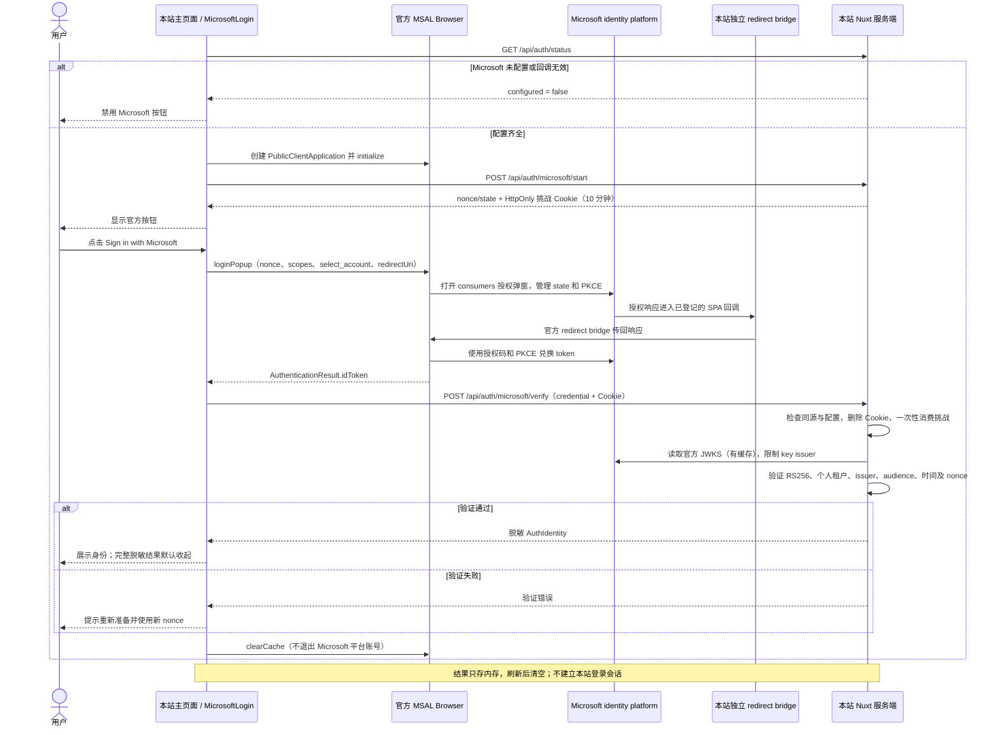

# Microsoft 个人账号登录

入口：`/`。当前支持 Outlook、Hotmail、Xbox 等**个人 Microsoft 账号**；工作或学校账号不在本例范围内。

实现使用官方 `@azure/msal-browser@5.29.0` 的 `loginPopup()`。MSAL 在浏览器内管理授权码流程、PKCE、OAuth state 和弹窗通信；本站服务端用 `jose` 验证 ID token，再返回脱敏身份。无需 Microsoft client secret，不调用 Microsoft Graph，不创建本站账户或持久会话。

登录入口使用官方 Microsoft 独立 SVG Logo 与文字，采用与 Google 入口一致的全宽白底、浅灰边框和圆角；图标与文字整体居中。

## 平台后台配置

1. 在 [Microsoft Entra 管理中心](https://entra.microsoft.com/) 进入 **App registrations → New registration**。
2. Supported account types 选择 **Personal Microsoft accounts only**。不要选择组织租户或将 authority 改为 common，本例服务端固定拒绝其他租户。
3. 添加 **Single-page application (SPA)** 类型的 Redirect URI：本地为 `http://localhost:3000/auth/callback-microsoft`，生产为 `https://<本站域名>/auth/callback-microsoft`。端口、路径、协议与实际访问地址保持一致。
4. 保存并复制 **Application (client) ID**。不用创建 client secret，不用开启 implicit grant/hybrid flow 的 access token 或 ID token 选项。
5. 本例只显式申请 `openid profile email`；不添加 `User.Read` 或其他 Graph 业务权限。MSAL 自身还默认追加 `offline_access`，因此不能将此示例描述为“完全不申请刷新权限”。

本地统一使用 `localhost`，不要用未登记的 `127.0.0.1`。生产使用 HTTPS。公开 client ID 不是秘密，但必须来自自己可管理的应用注册；配置状态为 configured 不表示微软后台已登记对应回调。

## 环境变量与运行

向已有 `.env` 追加以下分组，不覆盖其他 provider 配置：

```dotenv
NUXT_PUBLIC_MICROSOFT_CLIENT_ID=<Application (client) ID>
NUXT_PUBLIC_MICROSOFT_REDIRECT_URI=
```

回调变量为空时，浏览器和服务端分别以当前请求 origin 推导 `/auth/callback-microsoft`。也可填写完整回调 URL；必须与本站同源、使用固定路径、不含查询参数或 fragment，且为 HTTPS 或 localhost HTTP。无效配置会禁用入口。反向代理需正确保留站点协议与 Host，并单独确保回调响应不被添加 COOP。

```bash
pnpm install --frozen-lockfile
pnpm dev
```

修改环境变量后重启开发服务。生产构建使用 `pnpm build`，运行 `.output/server/index.mjs` 时注入 `NUXT_PUBLIC_MICROSOFT_CLIENT_ID` 等配置；生产服务不会自动加载本地 `.env`。

## 完整流程图



SDK 初始化和 start 请求在组件挂载时完成；用户点击时直接调用 `loginPopup()`，不在点击后先等待 start 请求。SDK 接管授权码与 PKCE 的生成、兑换，业务组件不自行拼授权 URL、管理 popup 或交换 code。

## start 与 verify 接口

### POST /api/auth/microsoft/start

无业务请求体。要求同源 Origin、有效配置及可接收 Cookie。服务端替换当前浏览器旧 Microsoft 挑战，保存随机 nonce、state 等临时数据，并返回：

```json
{ "nonce": "<本次挑战随机数>", "state": "<通用挑战结构中的随机状态>" }
```

挑战 ID 只放在 `oauth_demo_microsoft` Cookie：HttpOnly、SameSite=Lax、path=/，HTTPS 时 Secure。挑战有效期 10 分钟，单进程存储，上限与其他 provider 共用 1000 条。

这里的 state 和 verifier 来自通用挑战结构，Microsoft 组件不使用它们；OAuth state、PKCE verifier 由 MSAL 单独管理。本站通过 nonce + 挑战 Cookie 绑定浏览器和本次登录。前端只将服务端 nonce 传给 `loginPopup()`。

### POST /api/auth/microsoft/verify

同源 POST，自动携带挑战 Cookie；业务请求体只包含 MSAL 返回的 ID token：

```json
{ "credential": "<AuthenticationResult.idToken>" }
```

服务端检查 Origin 和配置后，先清 Cookie 并一次性消费挑战，再检查 credential（非空字符串，最多 20000 字符）和签名。消费后无论成功或失败均需重新 start。

验证要求：

- 算法 RS256，签名来自固定官方 `https://login.microsoftonline.com/consumers/discovery/v2.0/keys`。
- 仅允许 key issuer 为个人账号 issuer 或官方 `{tenantid}` 模板；模板按固定个人 tenant 解释。不从未验证 JWT 中读取任意公钥地址。
- token issuer 精确为 `https://login.microsoftonline.com/9188040d-6c67-4c5b-b112-36a304b66dad/v2.0`，不是带 consumers 的 authority URL。
- `tid` 等于 `9188040d-6c67-4c5b-b112-36a304b66dad`，`ver` 等于 `2.0`，audience 等于配置的 client ID。
- 必须有 `sub`、`iat`、`nbf`、`exp`、`nonce`、`tid`、`ver`；检查时间有效性并安全比较 nonce。

成功返回统一身份：

```json
{
  "provider": "microsoft",
  "subject": "<已验签的 sub>",
  "name": "<可选姓名，也可能为 null>",
  "email": "a***@outlook.com",
  "emailVerified": false
}
```

`sub` 在当前应用和固定个人 issuer 范围内解释，不能拿邮箱作为身份标识。`name`、`email` 可缺失，不用 `preferred_username` 补邮箱。`emailVerified: false` 表示本例未取得可靠的已验证邮箱声明，不表示已证实用户邮箱未验证。原始 token 或额外 token 声明不会返回。

错误包括非同源 `403`、未配置 `503`、容量上限 `429`、挑战或参数无效 `400`、token 验证失败 `401`。`POST /api/auth/microsoft/cancel` 可幂等清理挑战。

## 官方 MSAL v5 redirect bridge

回调 `/auth/callback-microsoft` 是服务端返回的独立 HTML，只有静态标题、处理提示，以及同源 `/auth/microsoft-bridge.js` 模块脚本，不是 Nuxt 页面。脚本通过官方 `@azure/msal-browser/redirect-bridge` 调用 `broadcastResponseToMainFrame()`，使用 SDK 的弹窗通信机制。

本地 Nuxt module 用 esbuild 在开发启动/构建时打包官方 bridge，生成文件放在已忽略的 `.cache/microsoft-bridge`（避免被 Nuxt 清理构建目录时删除），通过 Nitro serverAssets 随生产服务发布。不要把 npm 包名直接放进浏览器 import，也不要改成第三方 CDN 脚本。

回调响应设置 `Cache-Control: no-store`、`Referrer-Policy: no-referrer`，不带 `Cross-Origin-Opener-Policy`；若部署平台或反向代理统一加 COOP，需要对该路径排除。不要把回调改为首页、添加其他脚本或自行清掉 SDK 尚未处理的响应参数。

## 缓存、取消与重试

MSAL 的账号/token 缓存配置为 `MemoryStorage`；v5 的临时交互状态与 PKCE 等认证事务仍使用 sessionStorage。业务身份结果不写入任何浏览器 storage。SDK 默认可能取得刷新 token，业务不调用 `acquireTokenSilent()`、不使用刷新能力、不调用 Graph。流程结束调用 `clearCache()` 清理 SDK 本地缓存，不调用会退出平台账号的 `logoutPopup()`。

取消、弹窗被拦截、超时或本站验证失败后清理挑战，点击“重新准备 Microsoft 登录”获取新 nonce，再点击官方按钮登录。重复点击被阻止；组件卸载后不会继续提交迟到的弹窗 token 或展示旧结果，未消费挑战在下次 start 被替换或到期失效。

MSAL v5 使用 BroadcastChannel 通信。用户直接关闭弹窗时，SDK 不一定立即发现，可能需要等默认约 60 秒超时后才可重试；本例不自行轮询窗口，也不自动改成整页跳转。此示例面向普通顶层浏览器页面，不处理跨站 iframe 内登录。

## 验证与常见问题

```bash
pnpm test
pnpm typecheck
pnpm lint
pnpm build
# 启动开发或生产服务后：
AUTH_SMOKE_URL=http://localhost:3000 pnpm test:smoke
```

离线测试验证个人 tenant、签名及 key issuer、audience、时间/nonce、挑战过期重放、实际 Vue 组件的点击/取消/拦截/失败重试和卸载处理；smoke 检查 bridge HTML、打包脚本及文档可访问。SDK 桩和模拟 JWT 不代表 Microsoft 平台授权已验收。

真实验收需在应用登记的来源分别测试开发与生产构建：个人账号成功、工作/学校账号被拒绝、取消及关闭弹窗、失败后重新准备、结果展开及刷新清空。用 Chrome/Edge 和 Safari 检查弹窗行为。

| 现象 | 排查 |
| --- | --- |
| 按钮禁用 | 检查 client ID、同源回调路径及协议，修改后重启 |
| redirect_uri_mismatch / AADSTS50011 | SPA 类型、协议、主机、端口、路径需与实际 redirectUri 一致 |
| 登录窗口无法打开 | 允许本站弹窗，确保从按钮点击发起；不要在点击前插入额外异步请求 |
| 授权后超时或弹窗没有返回结果 | 检查独立 bridge HTML/脚本能否同源访问、是否被加了 COOP 或缓存；不要使用普通 Nuxt 页面作为回调 |
| 工作或学校账号无法登录 | 当前设计仅接受个人账号，不修改 consumers authority 或服务端 tenant 限制来绕过 |
| 服务端验证失败 | 检查 client ID、系统时间、nonce/挑战是否过期或已消费；重新准备 |
| 邮箱为空 / emailVerified 为 false | 可选声明；身份以已验证的 sub 判断，不影响已通过的身份验证 |

## 官方参考

- [应用注册与受支持账号类型](https://learn.microsoft.com/en-us/entra/identity-platform/quickstart-register-app)
- [授权码流程与 PKCE](https://learn.microsoft.com/en-us/entra/identity-platform/v2-oauth2-auth-code-flow)
- [MSAL Browser 登录与 popup redirectUri](https://github.com/AzureAD/microsoft-authentication-library-for-js/blob/dev/lib/msal-browser/docs/login-user.md)
- [MSAL v5 redirect bridge](https://github.com/AzureAD/microsoft-authentication-library-for-js/blob/dev/lib/msal-browser/docs/redirect-bridge.md)
- [MSAL 默认 scopes](https://github.com/AzureAD/microsoft-authentication-library-for-js/blob/dev/lib/msal-browser/docs/resources-and-scopes.md)
- [MSAL 缓存](https://learn.microsoft.com/en-us/entra/msal/javascript/browser/caching)
- [ID token 验证](https://learn.microsoft.com/en-us/entra/identity-platform/id-tokens)
- [issuer 与签名 key 适用范围（同样适用于验证 ID token 的 Web 应用）](https://learn.microsoft.com/en-us/entra/identity-platform/access-tokens#validate-the-issuer)
- [ID token 声明及可选邮箱](https://learn.microsoft.com/en-us/entra/identity-platform/id-token-claims-reference)
- [Microsoft 登录按钮品牌与官方 SVG 素材](https://learn.microsoft.com/en-us/entra/identity-platform/howto-add-branding-in-apps)

业务组件在 `app/components/auth/MicrosoftLogin.client.vue`；SDK 初始化在 `app/utils/microsoft-sdk.ts`；服务端 provider 在 `server/providers/microsoft.ts`，验签在 `server/utils/microsoft-tokens.ts`。版本固定为 5.29.0；升级时同时核对 popup、bridge、nonce 和缓存 API，不套用旧版 MSAL 空白回调页方案。
